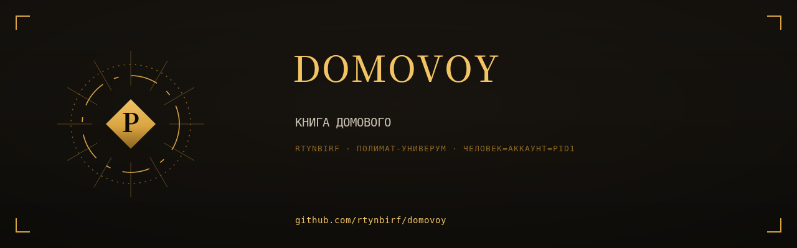

# КНИГА ДОМОВОГО

  

> Собрана 2026-11-11 из 6 репозиториев аккаунта rtynbirf. Каждая глава — снимок `main` оригинала на дату сборки (см. `PROVENANCE.md` внутри главы). Оригиналы архивированы read-only, история коммитов сохранена там.

## Оглавление

| Глава | Источник | Файлов | Коммитов в ориг. | Снимок |
|---|---|---|---|---|
| [domovenok](glavy/domovenok/) | [оригинал](https://github.com/rtynbirf/domovenok) | 125 | 21 | `1a8cf9b` |
| [domovoy-tweaker](glavy/domovoy-tweaker/) | [оригинал](https://github.com/rtynbirf/domovoy-tweaker) | 216 | 121 | `539b5ea` |
| [domovoy-ritual](glavy/domovoy-ritual/) | [оригинал](https://github.com/rtynbirf/domovoy-ritual) | 10 | 14 | `f88a6d2` |
| [khozyain](glavy/khozyain/) | [оригинал](https://github.com/rtynbirf/khozyain) | 9 | 1 | `5385fbb` |
| [H-PE11-PHOENIX](glavy/H-PE11-PHOENIX/) | [оригинал](https://github.com/rtynbirf/H-PE11-PHOENIX) | 190 | 239 | `b82eefa` |
| [os-forge](glavy/os-forge/) | [оригинал](https://github.com/rtynbirf/os-forge) | 48 | 34 | `965b17a` |

## О чём эта книга

Книга: дом-автомат одним томом — командный центр, твикер, ритуал, хозяин, ворклог PHOENIX, OS-FORGE. Собрано из 6 репозиториев rtynbirf.

## Как читать

Каждый каталог в `glavy/` — самостоятельная глава со своим README (если оно было в оригинале). Оглавление главы не переименовывалось: имена совпадают с именами исходных репозиториев, чтобы работали старые ссылки в документах.
