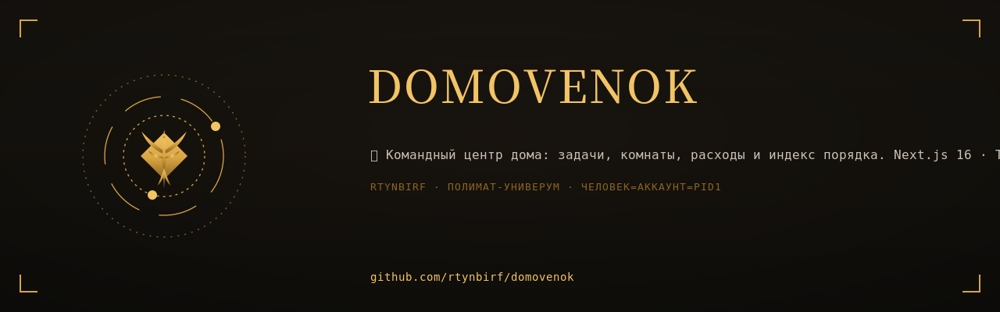
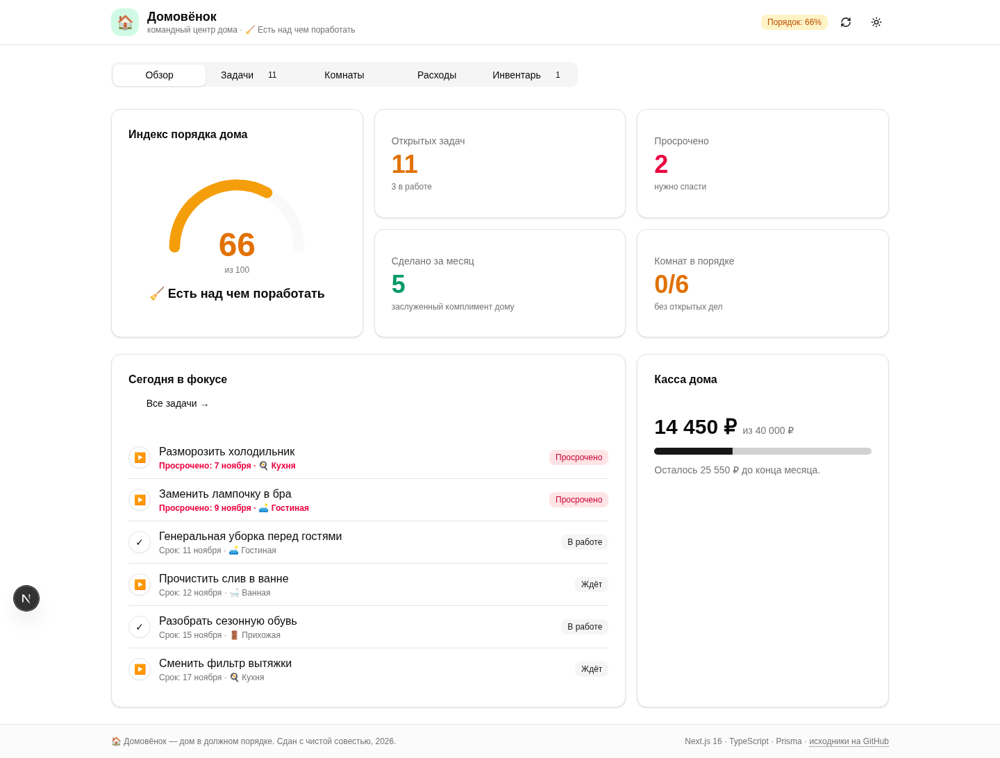
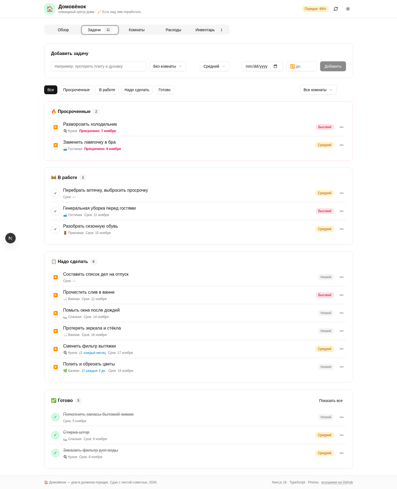
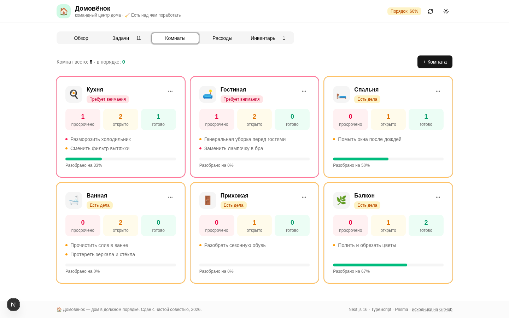
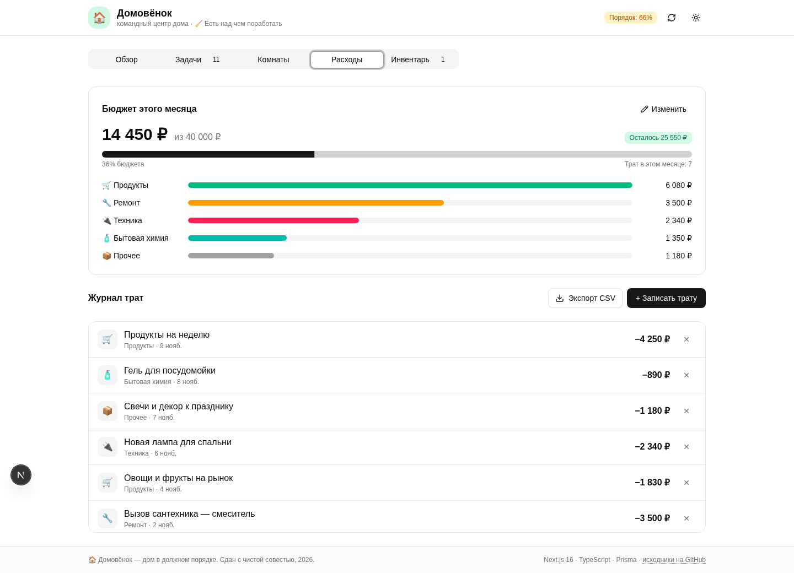
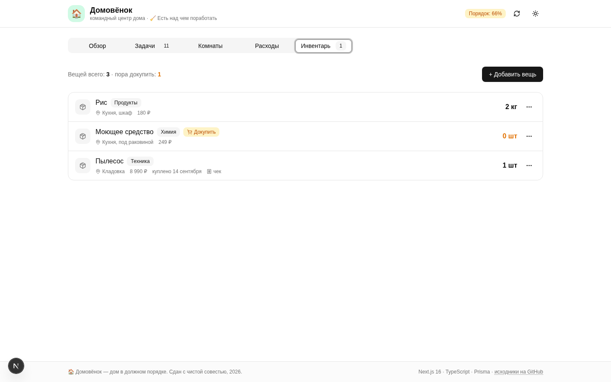
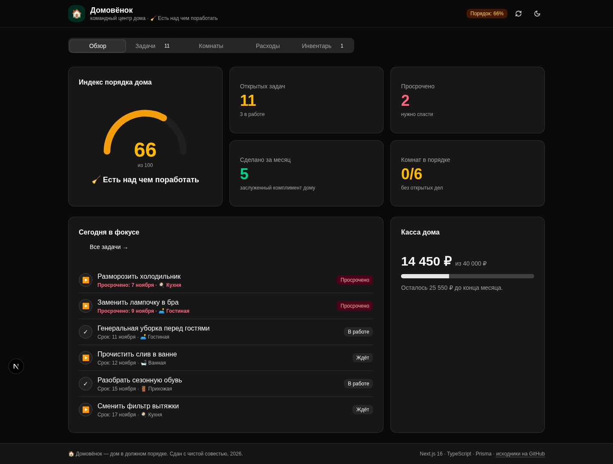

# 🏠 Домовёнок

<div align="center">
  
</div>


<div align="center">

**Командный центр вашего дома: задачи, комнаты, расходы и один честный «Индекс порядка».**

[](https://github.com/rtynbirf/domovenok/actions/workflows/ci.yml)
[](https://nextjs.org)
[](https://www.typescriptlang.org)
[](https://www.prisma.io)
[](https://bun.sh)
[](../../actions)
[](./LICENSE)



</div>

---

## Зачем это

У каждого дома есть хозяин, а у хозяина — список дел, который всегда длиннее, чем хотелось бы.
**Домовёнок** складывает весь дом в один экран и отвечает на главный вопрос:
*«в порядке ли жилище?»* — цифрой от 0 до 100, а не ощущением.

Всё зелёное — дом сияет. Что-то жёлтое — есть над чем поработать. Красное — тревога, хозяин!

## Что внутри

| Модуль | Умеет |
| --- | --- |
| **Обзор** | Спидометр «Индекс порядка дома», ключевые счётчики, «Сегодня в фокусе», касса дома |
| **Задачи** | Быстрое добавление, фильтры по статусу и комнате, просрочки, приоритеты, редактирование, 🔁 повторяшки |
| **Комнаты** | Карточка каждой зоны: сколько открыто, сколько просрочено, «разобрано на N%», свой статус |
| **Расходы** | Месячный бюджет, разбивка по категориям, журнал трат с удалением, экспорт в CSV |
| **Инвентарь** | Вещи дома: место хранения, цена, дата покупки и фото чека; минимальный запас и бейдж «Докупить» |

### Индекс порядка дома

Честная формула, покрытая юнит-тестами:

```
100
 − 2 за каждую открытую задачу          (не более −30)
 − 6 за каждую просроченную             (не более −36)
 − до 20 за перерасход бюджета          (−5 за каждые 5% превышения)
 + 2 за каждую комнату без открытых дел (не более +10)
 = Индекс 0…100
```

| Диапазон | Вердикт |
| --- | --- |
| 90–100 | ✨ Дом сияет |
| 75–89 | 🏡 Порядок! |
| 50–74 | 🧹 Есть над чем поработать |
| 25–49 | 🌪️ Запущенно |
| 0–24 | 🚨 Тревога, хозяин! |

### Повторяшки 🔁

Делу можно задать интервал — «каждые N дней» (1…365). Как только дело завершено,
Домовёнок тут же заводит следующее повторение с честной датой от старого срока,
перекатывая его вперёд, чтобы просрочки не копились. История завершений остаётся.

## Скриншоты

| Задачи | Комнаты |
| --- | --- |
|  |  |

| Расходы | Инвентарь |
| --- | --- |
|  |  |

| Тёмная тема |
| --- |
|  |

## Стек

- **Next.js 16** (App Router, Turbopack) + **React 19** + **TypeScript 5** (strict)
- **Tailwind CSS 4** + shadcn/ui (New York) + Lucide + Framer Motion
- **Prisma 6 + SQLite** — ноль внешних зависимостей, дом живёт в одном файле
- **Bun** — установка, запуск, тесты
- **Vitest** — юнит-тесты чистой логики
- **GitHub Actions** — линт, типы, тесты и сборка на каждый коммит; actions запинены по хешам, права минимальны
- **Dependabot** — еженедельный дозор зависимостей и workflow-экшенов
- **PWA** — манифест, свои иконки и офлайн-режим (service worker)

## Быстрый старт

```bash
# 1. Зависимости
bun install

# 2. База данных (создаст db/custom.db по схеме prisma/schema.prisma)
cp .env.example .env
bun run db:push

# 3. Запуск
bun run dev          # http://localhost:3000
```

При первом запросе дом сам засеется демо-данными: 6 комнат, задачи и траты — можно играть сразу.

## Скрипты

| Команда | Что делает |
| --- | --- |
| `bun run dev` | Дев-сервер на :3000 |
| `bun run build` | Прод-сборка (standalone) |
| `bun run lint` | ESLint (конфиг Next.js 16) |
| `bun run typecheck` | `tsc --noEmit`, strict |
| `bun run test` | Vitest, юнит-тесты |
| `bash scripts/smoke.sh` | Дымовая проверка живого дома: страницы, PWA, CSV, повторяшки |
| `bun run db:push` | Схема Prisma → база |

## Структура

```
src/
├── app/
│   ├── api/               # bootstrap, tasks, rooms, expenses, inventory, settings
│   ├── layout.tsx         # Inter + Manrope (кириллица), темы, тосты
│   └── page.tsx           # единственный экран приложения
├── components/
│   ├── home/              # overview / tasks / rooms / expenses / inventory + спидометр
│   └── ui/                # shadcn/ui
├── hooks/use-house.ts     # данные + мутации с авто-обновлением
└── lib/
    ├── home-index.ts      # чистая логика индекса (под тестами)
    ├── recurring.ts       # чистая логика повторяшек (под тестами)
    ├── inventory.ts       # чистая логика инвентаря (под тестами)
    ├── csv.ts             # чистая логика CSV-экспорта (под тестами)
    ├── house.ts           # сид и сводка по дому
    ├── types.ts           # справочники и DTO
    └── db.ts              # Prisma client
public/
├── manifest.webmanifest   # PWA-манифест
├── sw.js                  # service worker: офлайн-оболочка
└── icons/                 # свои иконки дома (192/512/maskable/apple)
tests/unit/                # Vitest
prisma/schema.prisma       # Room / Task / Expense / InventoryItem / Setting
scripts/                   # make-icons, smoke-проверка дома
.github/workflows/ci.yml   # lint → types → tests → build
```

## API

| Метод | Маршрут | Назначение |
| --- | --- | --- |
| GET | `/api/bootstrap` | Всё состояние дома одной выборкой |
| GET/POST | `/api/tasks` | Список / создание задач (в т.ч. регулярных) |
| PATCH/DELETE | `/api/tasks/[id]` | Правка (статус, срок, приоритет, повтор) / удаление; завершение повторяшки рождает следующее повторение |
| GET/POST | `/api/rooms` | Список / создание комнат |
| PATCH/DELETE | `/api/rooms/[id]` | Переименование / удаление |
| GET/POST | `/api/expenses` | Список / добавление трат |
| GET | `/api/expenses/export` | Журнал трат в CSV (Excel-дружелюбный: BOM + «;») |
| DELETE | `/api/expenses/[id]` | Удаление траты |
| GET/POST | `/api/inventory` | Список / добавление вещей (фото чека — data URL, ужимается на клиенте) |
| PATCH/DELETE | `/api/inventory/[id]` | Правка / удаление; `receiptImage: null` убирает фото |
| GET/PUT | `/api/settings` | Месячный бюджет |

## Устав дома 📜

Правила, по которым вылизан этот репозиторий:

1. **Всё зелёное** — CI (линт, типы, тесты, сборка) обязан быть зелёным на каждом коммите.
2. **Никаких секретов в коде** — `.env` в игноре, есть `.env.example`.
3. **Типы не обсуждаются** — TypeScript strict, `tsc --noEmit` проходит без ошибок.
4. **Логика отделена от интерфейса** — формулы живёт в `lib/` и покрыта тестами.
5. **Пользователь не должен догадываться** — русские тексты, тосты, скелетоны, состояния ошибок.
6. **Дома и на телефоне одинаково уютно** — адаптив обязательный.
7. **Пайплайн под замком** — actions запинены по хешам коммитов (тег подделать можно, хеш — нет), права workflow-токена минимальны (`contents: read`), время джобы ограничено, зависимостями еженедельно занимается Dependabot.

## Дорожная карта

- [x] Регулярные дела — 🔁 повторяшки: завершение рождает следующее повторение
- [x] Инвентарь дома с фото чеков — вещи, минимальный запас, место хранения и бейдж «Докупить»
- [x] Экспорт расходов в CSV — кнопка «Экспорт CSV» на вкладке «Расходы»
- [x] PWA и офлайн-режим — манифест, иконки, service worker

## Лицензия

[MIT](./LICENSE) — делайте с домом что хотите, главное — держите его в порядке.
